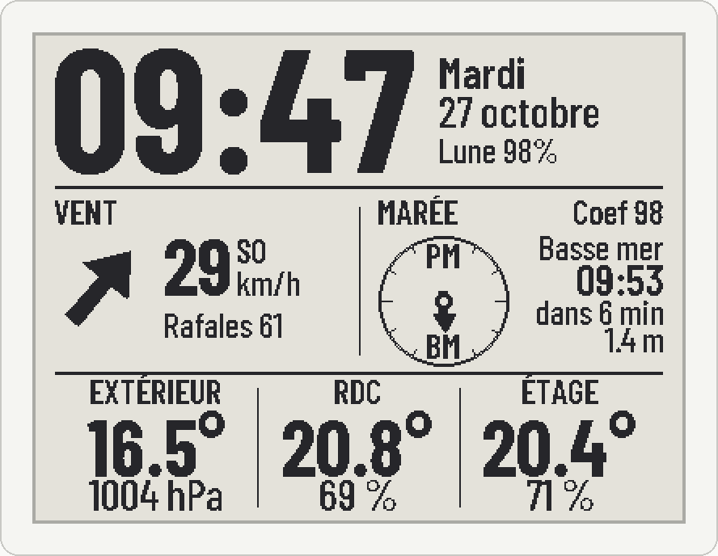
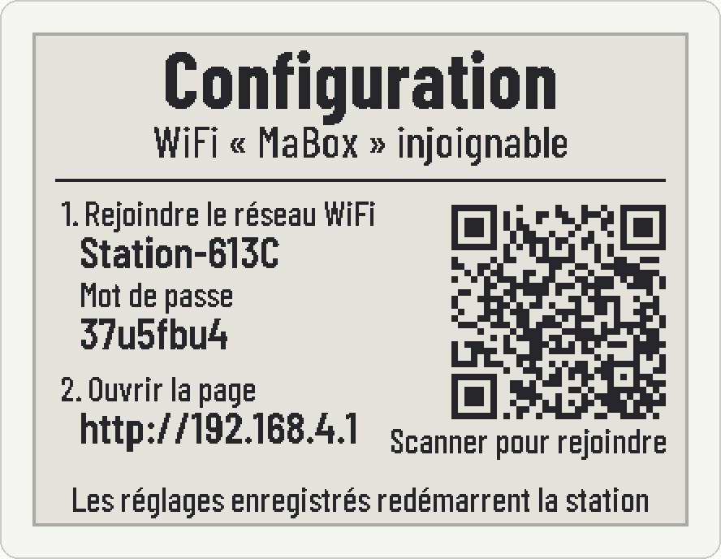

# Station météo e-paper

Firmware ESP32 d'une station d'affichage sur écran e-paper 4,2" (400 × 300,
noir et blanc). Elle affiche l'heure, la lune, la marée, le vent et les
températures, à partir de données publiées par Home Assistant en MQTT.



## Matériel

- Carte **LOLIN D32** (ESP32).
- Écran e-paper 4,2" GDEW042T2 (pilote GxEPD2 `GxEPD2_420`), câblé en SPI :
  CS 5, DC 17, RST 16, BUSY 4 (SCK 18, MOSI 23).

## Compiler et flasher

Avec [PlatformIO](https://platformio.org) :

```bash
pio run -e lolin_d32 -t upload           # version de production
pio run -e lolin_d32_debug -t upload     # avec traces sur le port série (115200)
```

`include/secrets.h` est facultatif : s'il existe (modèle dans
`include/secrets.h.example`), il fournit les identifiants WiFi et MQTT par
défaut. Sans lui, la station démarre directement en mode configuration.

## Configuration

Tous les réglages se font depuis la page web de la station, à l'adresse
`http://station.local` (ou par son adresse IP, rappelée sur l'écran de
démarrage) : WiFi, serveur MQTT, libellés des colonnes, heure du nettoyage
de l'écran, style de flèche, mot de passe d'administration (utilisateur
`admin`). Le **mode expert** permet de changer chaque sujet MQTT, l'entité de
prévision et le délai de péremption des mesures.

**Mode configuration** : la station ouvre son propre réseau WiFi
`Station-XXXX` quand aucun WiFi n'est configuré, quand le WiFi est injoignable
au démarrage, ou après **deux appuis sur reset à quelques secondes
d'intervalle**. L'écran affiche le nom du réseau, son mot de passe et un QR
code ; la page de réglages s'ouvre ensuite seule sur le téléphone (sinon
`http://192.168.4.1`).



## Mise à jour sans câble (OTA)

Elle exige un mot de passe d'administration défini sur la page.

- **Page web**, section « Mise à jour du firmware » : envoyer
  `.pio/build/lolin_d32/firmware.bin`.
- **PlatformIO**, depuis le réseau local :

  ```bash
  STATION_OTA_PASSWORD='mot-de-passe-admin' pio run -e lolin_d32_ota -t upload
  ```

## Données attendues (MQTT)

Sujets par défaut, modifiables dans le mode expert ; messages retenus
(`retain`) pour un affichage immédiat au démarrage.

| Sujet | Contenu |
|---|---|
| `station/tide` | `days[].events[]` : `time` (ISO 8601 avec fuseau), `tide` (`HIGH`/`LOW`), `height_m`, `coefficient` (peut être `null`) |
| `station/outdoor` | `temperature`, `pressure`, `updated_at` |
| `station/ground` | `temperature`, `humidity`, `updated_at` |
| `station/floor` | `temperature`, `humidity`, `updated_at` |
| `station/forecast` | `{"weather.trelevern": {"forecast": [...]}}` : `datetime`, `wind_speed`, `wind_bearing`, `wind_gust_speed` |

Une mesure dont `updated_at` date de plus de 3 h s'affiche `--`. Les
modifications conseillées côté Home Assistant sont décrites dans
[docs/modifications_HA.md](docs/modifications_HA.md).

## Prévisualiser l'écran sans flasher

```bash
pio run -e lolin_d32          # une fois, pour installer les bibliothèques
tools/preview/render.sh       # régénère les images de docs/
```

Le script compile `src/main.cpp` sur le PC avec des shims Arduino et GxEPD2
(`tools/preview/shim/`), lui fournit des messages d'exemple au format de
Home Assistant et produit les écrans principal, périmé, vide, de démarrage
et de configuration. Prérequis : `g++`, `gcc` et Python avec Pillow.

## Organisation

| Chemin | Rôle |
|---|---|
| `src/main.cpp` | Affichage, horloge, MQTT, démarrage |
| `src/station_config.*` | Réglages en mémoire non volatile, point d'accès, double reset |
| `src/web_portal.*` | Page web, portail captif, mise à jour OTA |
| `include/station_fonts.h`, `include/fonts/` | Polices (Barlow Condensed, licence OFL) |
| `tools/preview/` | Prévisualisation sur PC |
| `docs/` | Rendus de l'écran et échanges avec Home Assistant |

Historique des versions : [CHANGELOG.md](CHANGELOG.md).
